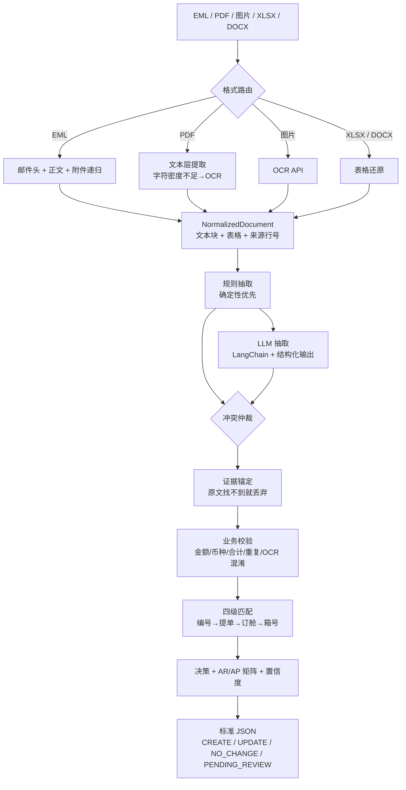

# sailbill-agent · 航运智能账单助手

> 把散落在 **邮件 / PDF / 扫描件 / Excel / Word** 里的运费账单，读成财务系统能直接入账的标准 JSON：
> 自动识别单据要素与费用明细、标准化费用名与币种、匹配已有账单做**增量更新**、判定 **AR/AP**、
> 拦截重复与冲突，并留下**可追溯的处理依据**。

[](pyproject.toml)
[](pyproject.toml)
[](LICENSE)
[](tests)
[](docs/harness.md)

> English: a LangChain-based agent that turns shipping Debit/Credit Notes (EML, PDF, scans,
> Excel, Word) into standardised, audit-ready JSON records — with bill matching, field-level
> incremental updates, AR/AP determination, duplicate/conflict detection and a deterministic-first
> harness that keeps the LLM honest.
>
> 📄 笔试题原文的完整转录与仓库约定见 **[AGENT.md](AGENT.md)**。

---

## 为什么不是"调个 LLM 抽字段"

账单自动化真正的难点不是"读懂文字"，而是**读懂之后不出错**：

| 现实问题 | 大多数做法 | 本项目做法 |
| --- | --- | --- |
| OCR 把 `40.00` 认成 `4O.OO` | 直接入库 4.00 | 先纠错再解析，并记录修正痕迹 |
| 单据里没有某个字段 | 统一填 `null` | 区分 `absent`（单据没有，可继承）与 `unknown`（有但读不清，必须复核） |
| 更新已有账单 | 整张覆盖 | 只改**有证据表明变更**的字段，其余继承原值 |
| 判断 AR 还是 AP | `Debit Note → AP` | 用 `签发方/接收方 × 记账主体` 矩阵，DN/CN 只决定方向 |
| 模型编了个金额 | 靠 prompt 祈祷 | 每个字段回查原文，找不到依据就丢弃 |
| 效果到底好不好 | 人眼看几个样例 | 6 用例金标集 + 9 项指标 + CI 门禁 |

---

## 快速开始（3 分钟，无需 API Key）

```bash
git clone <your-repo-url> && cd sailbill-agent
python -m venv .venv && . .venv/bin/activate      # Windows: .venv\Scripts\activate
pip install -e ".[dev,llm]"
python scripts/make_samples.py                     # 生成合成样本（不含任何真实客户数据）
sailbill demo                                      # 跑通全链路
```

```
文件                           操作             费用                        金额  币种   AR/AP
------------------------------------------------------------------------------------------
Debit Note DN-202609-001.pdf   NO_CHANGE      Ocean Freight           2,750.00  USD    AP
Debit Note DN-202609-001.pdf   UPDATE         Terminal Handling Charge  300.00  USD    AP
Debit Note DN-202609-001.pdf   NO_CHANGE      Documentation Fee          50.00  USD    AP
Debit Note DN-202609-001.pdf   CREATE         Customs Clearance Fee      80.00  USD    AP
Debit Note DN-202609-001.pdf   CREATE         Handling Charge            40.00  USD    AP
ar_debit_note.pdf              CREATE         Ocean Freight           1,850.00  USD    AR
pending_debit_note.pdf         PENDING_REVIEW Terminal Handling Charge  180.00  USD    AP
------------------------------------------------------------------------------------------
```

输出就是题目要求的标准 JSON（每个费用项一条记录）：

```json
[
  {
    "operation": "UPDATE",
    "document_info": {
      "document_type": "Debit Note",
      "reference_no": "DN-202609-001",
      "document_date": "2026-09-20"
    },
    "transaction_party": {
      "issuer": "ABC Logistics (Shanghai) Co., Ltd",
      "recipient": "XYZ Freight Forwarding Ltd"
    },
    "charge_details": {
      "charge_item": "Terminal Handling Charge",
      "amount": 300.0,
      "currency": "USD",
      "payment_term": "CC"
    },
    "financial_attributes": {
      "accounting_entity": "XYZ Freight Forwarding Ltd",
      "posting_type": "AP"
    },
    "audit_trail": {
      "ai_reasoning": [
        "来源文件 debit_note.pdf（pdf），共识别 5 条费用，本记录对应「Terminal Handling Charge (DEST)」",
        "费用行原文：Terminal Handling Charge (DEST)     2        150.00        300.00  USD       CC",
        "单据编号一致: DN-202609-001；费用名称一致: Terminal Handling Charge",
        "匹配到账单 B-1001，需变更字段：amount（金额 280.0 -> 300.0）",
        "记账主体是接收方 XYZ Freight Forwarding Ltd，该笔费用由签发方 ABC Logistics (Shanghai) Co., Ltd 向其收取 → 应付（AP）",
        "单据类型 Debit Note：确认方向为借方（正常计入 AP）",
        "置信度 0.98，扣分项：-0.02 匹配得分 0.90"
      ]
    }
  }
]
```

---

## 架构



| 层 | 目录 | 职责 |
| --- | --- | --- |
| 解析 | `src/sailbill/ingest/` | EML 递归附件、PDF 文本层判定、Excel/Word 表格还原、OCR 客户端与容错适配 |
| 抽取 | `src/sailbill/extract/` | 规则抽取（表格/文本/OCR）、LLM 抽取链、冲突仲裁、证据锚定 |
| 归一化 | `src/sailbill/normalize/` | 金额、ISO 4217 币种、费用名词典、PP/CC、交易主体别名 |
| 校验 | `src/sailbill/validate/` | 业务校验（阻断/警告/提示）+ 可解释置信度 |
| 决策 | `matching.py` / `finance.py` | 四级匹配、操作类型、AR/AP 矩阵 |
| 输出 | `output.py` / `pipeline.py` | 契约序列化、编排、trace |
| 评测 | `harness/` | 金标集、9 项指标、CI 门禁 |

---

## 与题目验收标准对照

| # | 验收要求 | 实现位置 | 验证方式 |
| --- | --- | --- | --- |
| 1 | 解析 EML 正文及附件 | `ingest/eml.py` + `router.load_tree` | `tests/test_ingest.py::test_eml_*` |
| 2 | 调用指定 OCR API | `ingest/ocr.py` | `tests/test_ocr_adapter.py`、`sailbill ocr <file>` |
| 3 | 解析 Excel / Word 费用表 | `ingest/excel.py`、`ingest/word.py`、`extract/tables.py` | `test_word_merged_cells_*`、`test_excel_rows_*` |
| 4 | 准确提取编号/费用/金额/币种 | `extract/rules.py` + 金标集 | `harness/run_eval.py` |
| 5 | 区分新增与更新 | `pipeline._decide_and_build` | `test_pdf_produces_expected_operations` |
| 6 | 结合记账主体判 AR/AP | `finance.py` | `test_document_type_alone_never_decides` |
| 7 | 检测重复与冲突 | `validate/business.py`、`extract/__init__.merge` | `test_duplicate_charge_is_reported`、`test_rules_win_on_numeric_conflict` |
| 8 | harness 工程提升稳定性 | `harness/` + `docs/harness.md` | `sailbill eval --min-score 0.9` |
| 9 | 5 点以上补充思考 | `docs/reflections.md` | 10 点（业务 + 技术） |
| 10 | Python + LangChain 实现 | `langchain-openai` + `langchain-core` | `extract/llm.py` |

---

## 配置

复制 `.env.example` 为 `.env`。**不配也能跑**：没有 Key 时自动走规则模式，全程不联网。

```bash
# 任意 OpenAI 兼容端点：DeepSeek / Qwen / 本地 vLLM
SAILBILL_LLM_MODEL=deepseek-chat
SAILBILL_LLM_BASE_URL=https://api.deepseek.com/v1
SAILBILL_LLM_API_KEY=sk-...

# 记账主体：不配置则 AR/AP 无法判定，记录会转 PENDING_REVIEW（刻意如此，不默认 AP）
SAILBILL_ACCOUNTING_ENTITY=

# OCR 服务
SAILBILL_OCR_ENDPOINT=http://36.103.199.11:5002
SAILBILL_OCR_TASK=orderChange

# 本地文件如何变成 OCR 能下载的 URL
SAILBILL_FILE_DELIVERY=auto          # auto | public | upload | none
SAILBILL_PUBLIC_BASE_URL=            # 例：https://cdn.example.com/bills
SAILBILL_UPLOAD_ENDPOINT=            # 任意支持 multipart 上传并返回链接的服务
```

### OCR 的一个硬约束（本项目踩过的坑）

题面给的 OCR 服务接收的是 **`file`: 一个 URL**，由服务端自己下载 —— 它访问不到你的 `localhost`。
因此"本地文件 → 公网 URL"必须显式解决，本项目提供四种投递策略：

| 策略 | 适用 | 说明 |
| --- | --- | --- |
| `public` | 已有对象存储/CDN | 文件名拼到 `SAILBILL_PUBLIC_BASE_URL` |
| `upload` | 临时演示 | POST 到文件托管服务，取回链接后交给 OCR |
| `url` 直传 | 云端文件 | `sailbill --url https://...` 直接透传 |
| `none` | 离线评测/CI | 用录制好的 OCR 响应回放，全流程可测 |

OCR 响应按文件 `sha256` 缓存，重跑零成本；`SAILBILL_OCR_FOR_PDF=true` 可强制让有文本层的 PDF
也走一遍 OCR，用于**双通道交叉校验**。

## 真实样本回归（`TestSamples/`，不随仓库分发）

拿到题面提供的真实单据后，逐份跑通并修掉了 6 个真实版式问题：

| 真实文件 | 结果 |
| --- | --- |
| `PDF 示例账单2.pdf`（US 风格 Debit Note） | 3 条费用 `65.00 + 1310.40 + 35.00 = 1410.40`，与单据 `TOTAL AMOUNT` **分账闭合**；编号 `DC-108478`、日期、`NEPTUNE SHIPPING LIMITED → AEBO TCO IMPORT LLC` 全部正确；指定记账主体后 **CREATE ×3 / AP** |
| `PDF示例账单1.pdf`（CMA CGM Arrival Notice） | 抽出 `On Carriage` `245.00 USD`，等于 `TOTAL CHARGES TO BE PAID`；但该单据交易方是**表格列头**（`SHIPPER NOTIFY / CONSIGNEE`），无法可信定位，故 AR/AP 不判定 → `PENDING_REVIEW` |
| EML 的 `MBL.pdf` / `HBL.pdf` | 提单无费用 → `PENDING_REVIEW`（`DOC_TYPE_UNSUPPORTED`），不硬凑记录 |
| `图片示例.png`、EML 的 `JPG` 附件 | 需 OCR；本地文件必须先变成**公网 URL**。本机网络下临时文件托管（file.io）TLS 不通，因此走 `PENDING_REVIEW` 并明确提示；生产应改为对象存储预签名 URL |

真实数据暴露并修复的问题（每条都有回归测试）：

1. `_LABEL_SEP` 里的 `\s*` 会吃掉换行，导致空标签（如列头 `CONSIGNEE`）把**下一行**当成自己的值 → 改为 `[ \t]*`；
2. 标签 `to` 会命中 `TOTAL`，把单据总额行当成了接收方 → 标签后加 `(?![A-Za-z])` 边界；
3. `ALL`、`COD`、`THE` 都是合法 ISO 4217 代码，普通过英文会被当成币种 → 币种必须有金额/币种词上下文并过滤停用词；
4. `TOTAL 1,410.40 0` 用"行内最右数字"取到 `0` → 合计行改用标签后**第一个**数字；
5. 空格对齐的 `rate qty P/C amount` 费用表（`P`=预付/`C`=到付）与 `On Carriage Additional ... USD 245.0000` 这类行原先完全抽不到 → 新增两种行形态解析；
6. 交易方取值可能是句子（`the account of the cargo`）或表格残片（`FREE BUSINESS`）→ 增加"公司名 vs 句子"判别与列头行识别。

> 以上验证可用 `pytest tests/test_real_samples.py` 复现（找不到 `TestSamples/` 时自动跳过）。

---

## 常用命令

```bash
sailbill run samples/debit_note.pdf --store samples/existing_bills.json      # 单文件
sailbill run samples/ --out out/records.json --trace out/trace.json          # 整目录 + trace
sailbill run samples/debit_note.xlsx --extended                              # 附带置信度/证据/匹配细节
sailbill run samples/ --entity "XYZ Freight Forwarding Ltd"                  # 指定记账主体
sailbill run samples/ --offline --no-llm                                     # 完全离线、纯规则
sailbill ocr samples/debit_note.pdf                                          # 只看 OCR 结构化结果
sailbill eval --min-score 0.9                                                # 金标评测（CI 门禁）
python harness/run_eval.py --llm                                             # 含大模型的评测
```

退出码：`0` 成功，`1` 出错或评测未达标，`2` 参数/输入问题 —— 便于接入流水线。

---

## 目录结构

```
sailbill-agent/
├─ AGENT.md                     # 题面原文完整转录 + 仓库约定
├─ src/sailbill/
│  ├─ ingest/      eml.py excel.py word.py pdf.py ocr.py router.py
│  ├─ extract/     rules.py tables.py llm.py prompts.py grounding.py from_ocr.py lexicon.py
│  ├─ normalize/   amounts.py currency.py charges.py payment.py parties.py dates.py html.py
│  ├─ validate/    business.py confidence.py
│  ├─ matching.py  finance.py  pipeline.py  output.py  store.py  config.py  models.py  cli.py
├─ harness/run_eval.py          # 金标评测 + 指标 + CI 门禁
├─ eval/golden/*.json           # 6 个金标用例
├─ samples/                     # 合成样本（脚本生成，无真实数据）
├─ scripts/make_samples.py      # 含极简 PDF 生成器（零第三方依赖）
├─ tests/                       # 136 个测试
└─ docs/  architecture.md · harness.md · reflections.md · adr/
```

---

## 设计决策（详见 `docs/adr/`）

1. **确定性优先**：金额、合计、匹配、ISO 币种、费用词典全部用代码算；模型只负责理解版式与语义。
2. **三态字段**：`present / absent / unknown`，让"没这个字段"和"读不出来"在更新语义上彻底分开。
3. **证据锚定**：模型输出的每个值都要能在原文定位，定位不到就降级为 `unknown`。
4. **输出契约严格**：默认只输出题目规定的键；调试信息进 `--extended`，绝不污染财务系统接口。
5. **歧义不猜**：多账单命中、主体不匹配、低置信度一律 `PENDING_REVIEW`，并写明原因。

---

## 路线图

- [x] 多格式解析 + 四级匹配 + AR/AP + 金标评测
- [ ] FastAPI 服务 + 异步任务队列（OCR 单页 20–30s，批量需要队列）
- [ ] 汇率与多币种折算（`fx_rate` 扩展字段）
- [ ] 人工复核 UI + 标注回流（把 `PENDING_REVIEW` 变成训练数据）
- [ ] 对账单（Statement of Account）拆单
- [ ] 对象存储直连（S3/OSS 预签名 URL），替代临时文件托管

---

## 数据与合规

- 仓库内 **全部为脚本生成的合成数据**，不含任何真实客户运费、公司或人名；
- 真实数据请放进 `samples/private/`（已在 `.gitignore` 中）；
- 密钥只通过环境变量/`.env` 提供，`.env` 不入库；
- 账单包含商业敏感信息，生产部署请开启日志脱敏并有明确的数据留存策略。

## 贡献

见 [CONTRIBUTING.md](CONTRIBUTING.md)。欢迎提 issue 补充费用名词典与真实版式（脱敏后）。

## License

[MIT](LICENSE)
