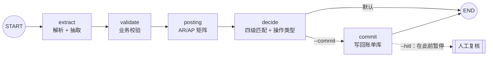

# 编排引擎：LangGraph 状态机

本项目是**单引擎**架构：所有单据都经过一张 LangGraph 状态图。没有第二套顺序执行路径，
也没有 `--engine` 开关——图就是 agent 的主干。

## 1. 图结构



节点就是业务本身（`src/sailbill/graph.py`）：`extract` 调 `extract_document`，
`validate` 调 `validate_extraction`，`posting` 调 `determine_posting`，
`decide` 循环调用 `match_charge` / `score_charge` / `decide_and_build`，
`commit` 调 `BillStore.apply_records`。业务规则仍住在 `pipeline.py` / `matching.py` / `finance.py`，
节点只负责"什么时候做、失败怎么办、能不能停"。

## 2. 图给了什么

| 能力 | 说明 |
| --- | --- |
| **写账前人工闸门** | `interrupt_before=["commit"]`：决策做完、账没写，人可以看、可以改、可以让它继续 |
| **阶段级断点** | 每个节点后都有 checkpoint，`graph.get_state(config).next` 直接告诉你停在哪一步 |
| **失败定位** | trace + checkpoint 双证据，不用猜是 OCR 还是抽取挂的 |
| **按单据分叉** | 条件边：不需要写账的场景（`--commit` 未开）直接到 END |
| **可视化** | 图就是结构，`docs/graph.md` 里的 mermaid 不是画出来的，是代码结构 |

## 3. 关键设计：图状态只放 JSON 原生数据

LangGraph 的 msgpack serde **无法往返任意 Pydantic 对象**。第一版把整个 `UnitState`
（含 `NormalizedDocument`、`DocExtraction`、`BillRecordOut`）放进图状态，结果 checkpoint
反序列化后 `records == []`——HITL 恢复时"什么都没提交"，而且**不报错**。

现在：

```python
class GraphState(TypedDict, total=False):
    doc_id: str          # 只放 id
    trace: dict          # 只放 JSON 原生数据
```

业务对象在进程内的 `registry: dict[str, UnitState]`，节点用 `doc_id` 取。

**代价（明确记录）**：`MemorySaver` 只在进程内有效，跨进程 resume 需要换 `SqliteSaver`
并把 `UnitState` 做成可序列化形态（已列路线图）。当前 HITL 适用于"同一次运行内
暂停 → 复核 → 恢复"，这也正是财务复核的常见形态。

## 4. 用法

```bash
# 图引擎 + 写回账单库
sailbill run TestSamples/ --commit --store bills.json --save-bills out/bills.json

# 写账前暂停，等人确认（同进程内 resume）
sailbill run bill.pdf --hitl --commit
#  → [sailbill] 1 个单据已在写账前暂停（LangGraph interrupt）
```

```python
from sailbill.pipeline import run_paths

result = run_paths(paths, hitl=True, commit=True, store=store)
unit = result.units[0]
assert unit.trace["paused_before_commit"] is True   # 还没写账
assert len(store.all()) == before
unit.graph.invoke(None, config=unit.graph_config)   # 人工确认后继续
assert len(store.all()) == before + 1
```

## 5. commit 的语义（容易踩坑的地方）

* **只写 `CREATE` / `UPDATE`**：`NO_CHANGE` 无需写，`PENDING_REVIEW` **绝不能**在人工确认前落账；
* **同名费用不合并**：真实 Debit Note 有两条 `HANDLING CHARGE`（65.00 / 35.00），按名字合并会丢钱。
  去重键是 `(标准费用名, 币种, 金额)`，所以同额同币才算"已存在"，**重跑幂等**；
* **`UPDATE` 走匹配到的具体行**（`matched_line`），不会误改同名另一行；
* 无记账主体时记录是 `PENDING_REVIEW`，`commit` 什么也不做——刻意如此。

## 6. 局限

* 跨进程 resume 需 `SqliteSaver`（见 §3）；
* 图是**单据级**的（每个账单单元一张图），还没有整批的父图；
* 用的是静态断点 `interrupt_before`；动态 `interrupt()`（节点内部按条件要人工输入）尚未使用。
