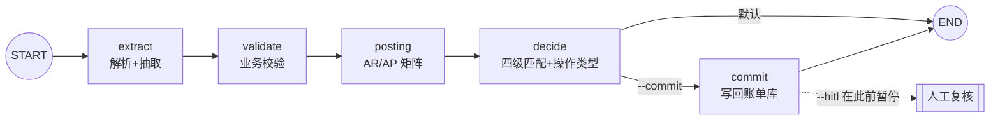

# 编排引擎：顺序管线 vs LangGraph

项目里有**两个引擎，跑同一套阶段函数**：

| 引擎 | 调用 | 依赖 | 适合 |
| --- | --- | --- | --- |
| `classic`（默认） | `for` 循环顺序执行 | 无额外依赖 | 批量、CI、确定性优先 |
| `langgraph` | `StateGraph` 状态机 | `pip install -e ".[graph]"` | 需要断点续跑、人工复核、可视化 |

两者的产物**被测试钉死为一致**：`tests/test_graph.py::test_graph_matches_classic` 对 6 个样本
逐条比较记录，真实样本上也是 8/8 完全相同。

## 1. 图结构



每个节点就是 `pipeline.py` 里的一个 `stage_*` 函数——**同一份逻辑，两种驱动程序**。

## 2. 为什么值得换成图

| 能力 | 顺序管线 | LangGraph |
| --- | --- | --- |
| 阶段级断点 | 无 | ✅ checkpointer 逐节点保存 |
| 写账前人工确认 | 只能整批重跑 | ✅ `interrupt_before=["commit"]` |
| 失败定位 | 看 trace 日志 | ✅ 直接读 checkpoint 的 `next` |
| 分支（无费用单据） | if/else | ✅ 条件边 |
| 可视化/审计 | 文档里的图 | ✅ 图即结构 |

## 3. 关键设计：checkpoint 里只放 JSON 原生数据

LangGraph 的 msgpack serde **无法往返任意 Pydantic 对象**。第一版把整个 `UnitState`（含
`NormalizedDocument`、`DocExtraction`、`BillRecordOut`）塞进 state，结果 checkpoint 反序列化后
`records` 变成空列表——HITL 恢复时"什么都没提交"，而且没有任何报错。

现在的做法：

```python
class GraphState(TypedDict, total=False):
    doc_id: str          # 只放 id
    trace: dict          # 只放 JSON 原生数据
```

业务对象留在进程内的 `registry: dict[str, UnitState]`，节点用 `doc_id` 取。

**代价（必须写清楚）**：`MemorySaver` 只在进程内有效，所以跨进程 resume 需要换成
`SqliteSaver` 并重新解析文档（或把 `UnitState` 改成 JSON 可序列化的形态）。这已列入路线图；
当前 HITL 的适用范围是"同一次运行内暂停 → 复核 → 恢复"。

## 4. 用法

```bash
# 图引擎 + 写回账单库
sailbill run samples/ --engine langgraph --commit \
  --store samples/existing_bills.json --save-bills out/bills.json

# 写账前暂停，等人确认（同进程内 resume）
sailbill run samples/debit_note.pdf --engine langgraph --hitl --commit
#  → [sailbill] 1 个单据已在写账前暂停（LangGraph interrupt）
```

```python
from sailbill.pipeline import run_paths
result = run_paths(paths, engine="langgraph", hitl=True, commit=True, store=store)
unit = result.units[0]
assert unit.trace["paused_before_commit"] is True   # 还没写账
assert len(store.all()) == before                   # 确实没写
unit.graph.invoke(None, config=unit.graph_config)   # 人工确认后恢复
assert len(store.all()) == before + 1               # 写进去了
```

## 5. commit 的语义（容易踩坑的地方）

* **只写 `CREATE` / `UPDATE`**：`NO_CHANGE` 无需写，`PENDING_REVIEW` **绝不能**在人工确认前落账；
* **同名费用不合并**：真实 Debit Note 有两条 `HANDLING CHARGE`（65.00 / 35.00），按名字合并会丢钱。
  去重键是 `(标准费用名, 币种, 金额)` —— 同额同币才算"已经存在"，因此**重跑幂等**；
* **`UPDATE` 走匹配到的具体行**（`matched_line`），不会误改同名另一行；
* 无记账主体时记录是 `PENDING_REVIEW`，`commit` 什么也不做——这是刻意的。

## 6. 局限

* 跨进程 resume 需 `SqliteSaver`（见上）；
* 图目前是**单据级**（每个账单单元一张图），没有做整批的父图；
* `interrupt_before` 是静态断点；动态 `interrupt()`（在节点内部按条件请求人工输入）尚未使用。
